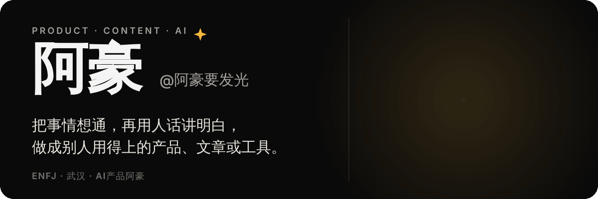
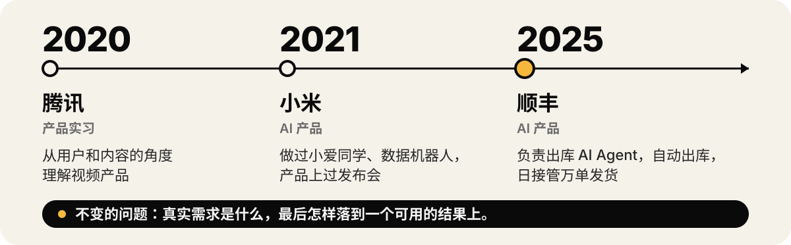

  

  <a href="https://ahaoai.vercel.app/"><b>🌐 个人网站</b></a>
  &nbsp;·&nbsp;
  <b>✍️ 公众号 / 小红书：AI产品阿豪</b>
  &nbsp;·&nbsp;
  📍 武汉

> 比起一长串标签，我更想让你知道：我关心一个东西到底有没有用，能不能解决具体的问题。
> AI 也一样——不只看它又多了什么能力，也看它值得放进哪一步，哪些地方还需要人来判断。

## 🏃 我在做什么

- **做「AI产品阿豪」的内容。** 拆解 AI 产品、硬件和大模型，写教程，也写做产品时的思考。希望你看完，不只认识一个新名词，还知道它跟自己有什么关系。
- **打磨自己的 AI 工作流。** 让 AI 参与资料整理、写作、图文和视频制作，摸索哪些步骤真的省事，哪些判断不能省。
- **搭建个人知识库。** 积累案例、母稿、模板和技能——一次好结果，不该做完就散在聊天里。
- **做自己的小产品。** 亲手做东西，遇到具体问题，再把过程讲出来，让内容和产品互相验证。

## 💫 一路走来

  

## 📍 我相信的三件事

- **做自己认同的事。** 不因为别人都在做就跟着做，先理解问题，再形成自己的判断。
- **Build in Public。** 把做的东西和过程分享出来，让想法接受反馈，也让同路人更容易找到彼此。
- **永远坦诚，重视口碑。** 口碑是穿越周期的核心资产。

## 💬 这些话题，我愿意一起聊

- **一个需求值不值得做？** 怎么从用户处境出发，而不是从功能清单出发。
- **AI 怎么进入真实业务？** 哪些步骤适合交给模型，哪些地方需要明确边界。
- **复杂的东西，怎么讲明白？** 把产品或概念拆成别人能理解、能行动的表达。
- **经验怎么留下来？** 让一次创作或项目里的收获，变成下次可用的案例、模板和知识。

<b>🤔 我还没想明白的事</b>

 

- **模型升级后，旧工具会不会变成限制？** 我希望框架能随模型进步一起变好，而不是把结果锁在旧办法里。
- **怎么让普通人也能越用越好？** 不只是让熟练的人更熟练，也要让没有经验的人稳定做出东西。
- **大模型的效果、速度和成本，怎么取舍？** 做得好很重要，值不值得这样做也很重要。
- **审美判断能不能被学习和复用？** 帮助普通人更好地做文档、图文和视频，而不是只靠碰运气。
- **内容里的需求，怎样长成真正值得做的产品？** 我想继续通过做东西来回答。

<b>📷 不工作的时候</b>

 

- **摄影：** 喜欢纪实摄影，也玩航拍，视觉中国签约摄影师。
- **音乐：** 弹民谣吉他，大学组过乐队、拿过十佳歌手，也业余学流行钢琴。
- **球类：** 乒乓球、羽毛球、篮球。

## 📮 在这些地方找到我

| 渠道 | 我在这里分享什么 |
| --- | --- |
| 🌐 [个人网站](https://ahaoai.vercel.app/) | 我的介绍、价值观和一路走来的故事；公众号、小红书二维码也在这里。 |
| ✍️ 公众号 · 小红书「AI产品阿豪」 | AI 产品、硬件、大模型拆解，实用教程，以及我的理解和思考。 |

如果我们关心的是类似的问题，欢迎交个朋友。谢谢你读到这里～
